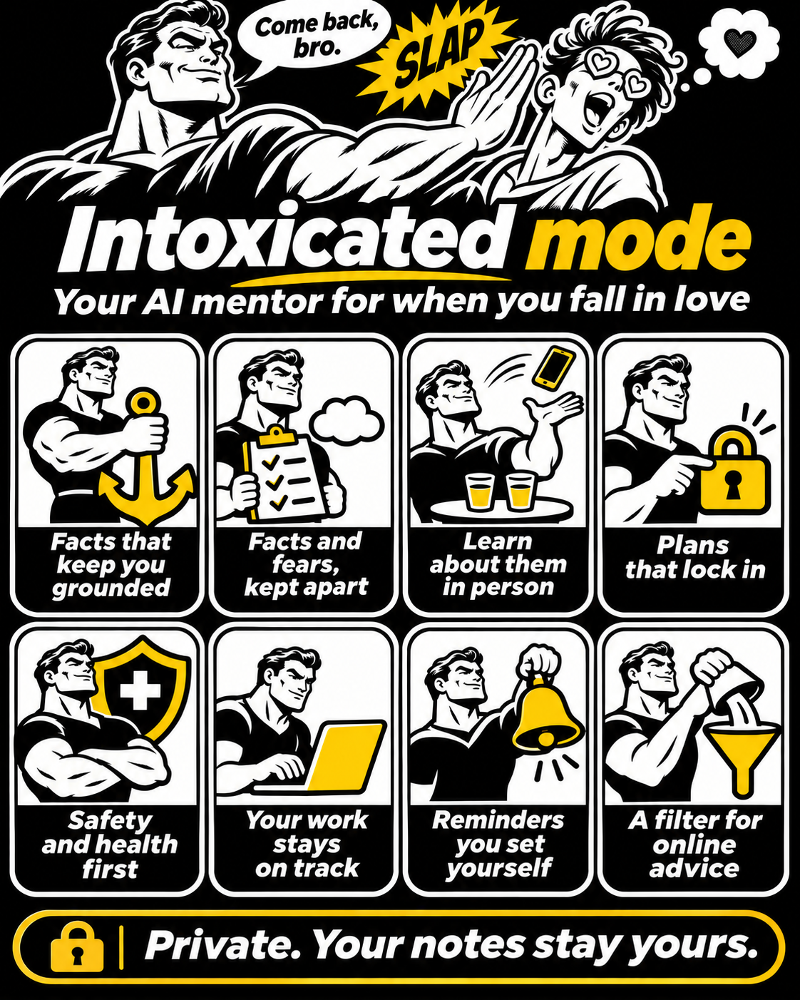

# Come back, bro

**Intoxicated mode: the AI that slaps you back to reality when you fall in love.**

A Claude skill (and a ChatGPT instruction set) that turns your assistant into a calm, funny relationship mentor for the first weeks of falling hard for someone. It grounds you with the facts you told it, turns anxious spirals into concrete plans, keeps your work on track and keeps notes about the other person to a minimum. Every rule is backed by research, listed in [EVIDENCE.md](come-back-bro/EVIDENCE.md).



## Where it came from

Five words: ten years closed, then someone.

The idea came out of a real case. One of us met someone, and within three days the person was living rent free in his head for twelve hours a day. Work slipped, sleep slipped, the plan for the first conversation got rewritten forty times. So he asked his assistant to switch into a new mode: remind me of the facts, keep me strict with work, help me build real plans. He called it intoxicated mode. It worked well enough that we cleaned it up and put it here, with every private detail removed.

## Why a skill for this

Falling for someone is a measurable state, and the numbers explain why a grounding tool helps:

- People in early-stage love told researchers they spend more than 85% of their waking hours thinking about the person. ([Fisher, Xu, Aron and Brown, Frontiers in Psychology, 2016](https://pmc.ncbi.nlm.nih.gov/articles/PMC4861725/))
- On average, people freshly in love think about their sweetheart 65% of the time. The top score in that study was 93%. ([Langeslag, University of Missouri St. Louis, 2015](https://blogs.umsl.edu/news/2015/04/22/in-love/))
- In a 2025 study, people in love said they think about the beloved 67% of the time, and they overwhelmingly enjoyed it. ([Langeslag and Philippi, Cognition and Emotion, 2025](https://pubmed.ncbi.nlm.nih.gov/39431980/))
- The intense phase typically lasts about 12 to 18 months. ([Fisher et al., 2016](https://pmc.ncbi.nlm.nih.gov/articles/PMC4861725/))
- In a small 1999 study (20 people per group), people in love for under six months showed lowered serotonin transporter density, similar to patients with obsessive compulsive disorder. ([Marazziti, Akiskal, Rossi and Cassano, Psychological Medicine, 1999](https://www.cambridge.org/core/journals/psychological-medicine/article/alteration-of-the-platelet-serotonin-transporter-in-romantic-love/9599BA293019DFA6D05B315803B6D2A7)) Treat it as a hint: a 2024 review by a leading love researcher calls the "love is like OCD" idea a hypothesis, and one study in women found the opposite direction. ([Langeslag, Behavioral Sciences, 2024](https://pubmed.ncbi.nlm.nih.gov/38785874/))
- They also had higher cortisol, the stress hormone, than singles and long-term couples. Re-tested 12 to 24 months later, every hormonal difference was gone. ([Marazziti and Canale, Psychoneuroendocrinology, 2004](https://pubmed.ncbi.nlm.nih.gov/15177709/))
- Teenagers freshly in love slept fewer hours and scored higher on a hypomania scale. The authors call early love "comparable to a hypomanic state". ([Brand et al., Journal of Adolescent Health, 2007](https://pubmed.ncbi.nlm.nih.gov/17577536/))
- 53% of British 18 to 24 year olds always look someone up on social media before a first date. Only 5% never do. ([YouGov, 2018](https://yougov.com/en-gb/articles/21474-would-you-go-date-someone-who-didnt-have-digital-f))

So: a brain under extra stress hormones, thinking about one person most of the day and mostly loving it, for a year or more. That brain could use a friend with a list of facts.

## What it does

| | Feature | In one line |
|---|---|---|
| 1 | Facts that keep you grounded | A list of real facts, as you told them. When you drift into fantasy, you get one line from that list. |
| 2 | Facts and fears, kept apart | Two columns: what you know and what you are guessing. A routine for the slow reply. |
| 3 | When the thoughts will not stop | A daily "person time" slot, an if-then plan and something absorbing to do. |
| 4 | Learn about them in person | No digging through profiles. Every "I want to know X" becomes a question or a game for the next date. |
| 5 | Plans that lock in | Place, time, follow-up questions, light games, the ride home. Once agreed, locked. You write your own messages. |
| 6 | Ask clearly, take a no | One clear invite, the first no is accepted, a vague answer counts as a soft no. |
| 7 | Their boundaries come first | Repeated messages after silence or turning up uninvited get named, every time. |
| 8 | Body, sleep and safety | Breathing that was actually tested, a kit for racing-mind nights, alcohol and driving, diabetes warnings without numbers. |
| 9 | A real crisis protocol | The jokes stop, a person and a helpline come first. |
| 10 | Your work stays on track | Every talk about the person ends with your next real commitment. |
| 11 | Reminders you set yourself | Rules you want to hear again, brought back at the right moment. |
| 12 | A filter for online advice | Bring a dating video or article and get it sorted into keep and toss. |

## Built on research

Version 1.1 was rebuilt on four research passes, each one checked against primary sources: early love and limerence, dating and first dates, body and safety, and how an AI mentor should behave (sycophancy, dependence, breaks, crisis handling).

- [EVIDENCE.md](come-back-bro/EVIDENCE.md) maps every rule to its sources.
- [research/](research/) holds the full notes, with sample sizes, strength ratings and the findings that failed to replicate.

Fair warning, said once: nobody has tested an intervention on people in the first weeks of dating. The skill borrows from studies of breakups, unrequited love, anxiety, sleep and chatbot use, and it says so.

## Install

### Claude Code

```bash
git clone https://github.com/Breakzoras/come-back-bro.git
cp -r come-back-bro/come-back-bro ~/.claude/skills/come-back-bro
```

Then in any session: `/come-back-bro` or just say "intoxicated mode".

### Claude.ai

Zip the `come-back-bro` folder and upload it under Settings, Capabilities, Skills.

### ChatGPT

Paste [chatgpt/instructions.md](chatgpt/instructions.md) into a Project's instructions or a custom GPT.

## Commands and phrases

| Say | What happens |
|---|---|
| `/come-back-bro` or "intoxicated mode" | Turns the mode on. It stays on for the whole conversation. |
| "come back bro" | Same, and a quick way to ask for a grounding line mid-spiral. |
| "lock it" | Marks the current plan as LOCKED. The assistant keeps it as is. |
| "remind me: ..." | Saves a rule you want to hear again, brought back at the right moment. |
| "keep or toss: <link or text>" | Sorts dating advice from the internet into keep and toss. |
| "end intoxicated mode" | Turns it off. |
| "coming back mode" or "I'm out" | Switches to coming back mode: a practical, painless exit when it did not work out. |
| "end coming back mode" | Turns coming back mode off. |

## How to use it

1. Say "intoxicated mode" and tell it about the person, in your own words.
2. Ask for what you need: a plan for the first conversation, a way to ask if they are single, what to do with the nerves, what to do with a video someone sent you.
3. When you spiral, say so. You will get facts and a plan.
   The messages you send stay yours: it offers options and you put them in your own words.
4. Say "end intoxicated mode" when you are out of the woods.
5. If it did not work out, say "coming back mode". You get a locked verdict, a plan for the chat and the socials, a script for places you still share, help when the thoughts come back, and worth reminders built on true facts about you.

## Privacy, honestly

The skill asks the assistant to keep personal details out of shared places: team wikis, group channels, shared project notes. It cannot make your chat more private than your AI provider already does, so read their terms and keep names out if you want to. Nothing in this repository contains anyone's real story.

## Not a substitute

This is a friend with a plan, and it says plainly that it is an AI. It suggests a professional when the signs call for one (neglected work or relationships, painful thoughts most days, longing that lasts months, checking you cannot stop), and in a crisis it puts a person and a helpline first.

## Contributing

Issues and pull requests are welcome, especially new grounding lines, first-date tools and translations. Keep the tone: warm, funny, no manosphere, no generalizations about all men or all women.

## License

MIT. Use it, change it, share it.
